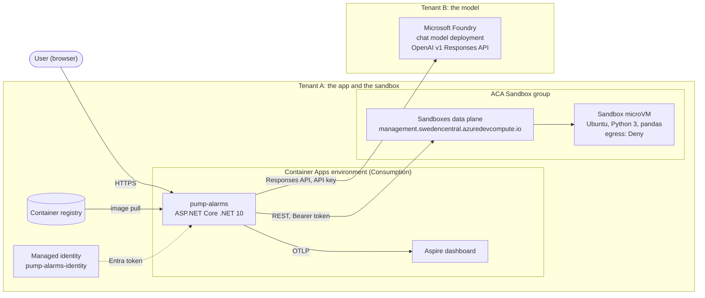
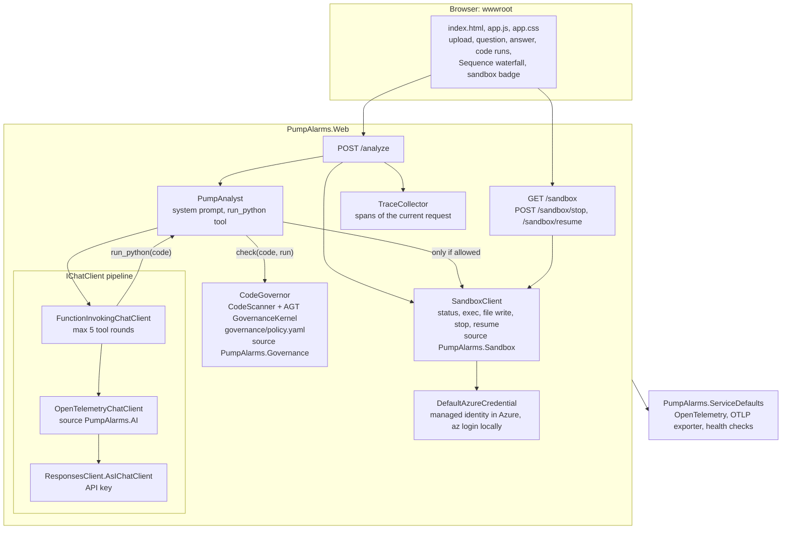
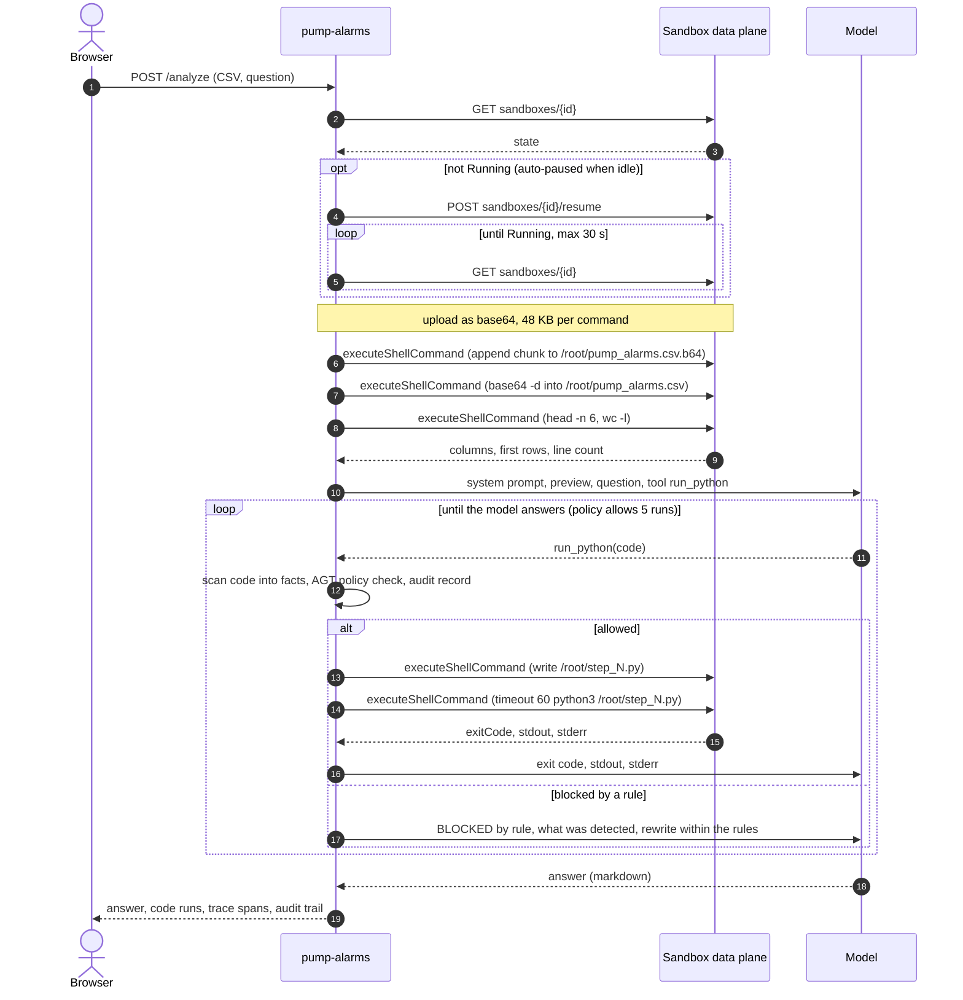
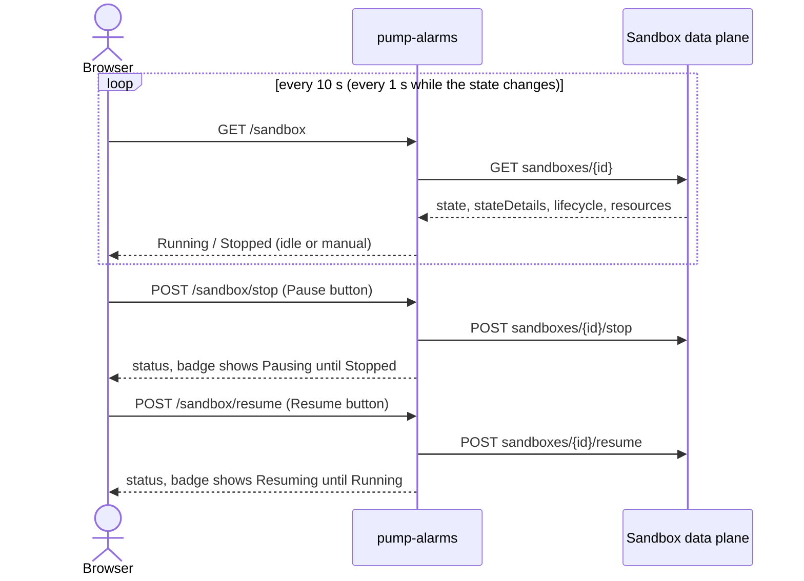
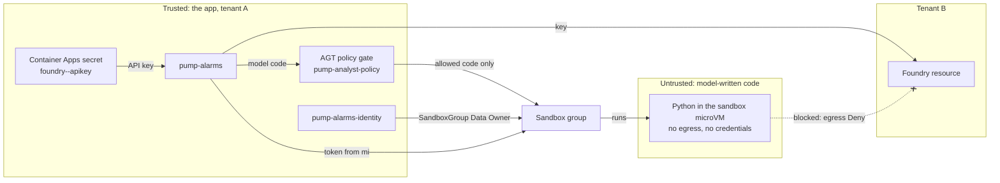
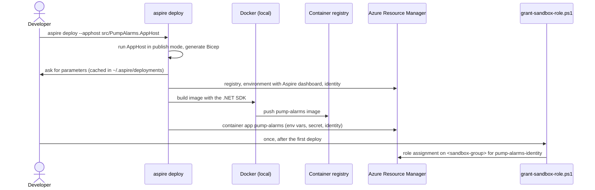

# Pump Alarm Analyzer: architecture

How the demo is built: the parts, how they talk, who trusts whom, and why it is built this way.
For features, setup and the demo script see [README.md](README.md).

---

## 1. Goals and constraints

| | |
|---|---|
| **Goal** | A user uploads pump alarms and asks a question; an AI model answers by writing and running Python. |
| **Key rule** | Code written by the model is untrusted. It never runs in the web app, only in an isolated sandbox without internet access. |
| **Governance** | Every script is checked against a policy (Agent Governance Toolkit) before it may reach the sandbox, and every decision is audited. |
| **Constraint: two tenants** | The sandbox and the app are in tenant A; the model (`<deployment>` (a GPT-class model)) is in tenant B. |
| **Constraint: no secrets in the repo** | IDs and keys live in user-secrets locally and in Aspire parameters / Container Apps secrets in Azure. |
| **Constraint: preview APIs** | ACA Sandboxes is new; its data plane is only partly documented. The app uses the smallest verified surface. |
| **Audience** | A 5-minute live demo: everything the model does must be visible (code, output, timeline). |

---

## 2. System context

| Element | Responsibility | Technology |
|---------|----------------|------------|
| **pump-alarms** | UI, analysis loop, policy gate and audit, sandbox control, tracing | ASP.NET Core minimal API, static HTML/CSS/JS, Agent Governance Toolkit (`Microsoft.AgentGovernance`, in process) |
| **ACA Sandbox** | runs model-written Python in isolation | ACA Sandboxes (preview data plane `2026-02-01-preview`) |
| **Foundry model** | plans the analysis, writes Python, writes the answer | `<deployment>` (a GPT-class model), OpenAI v1 Responses API with tool calling |
| **Managed identity** | the app's identity towards the sandbox | user-assigned identity, role *Container Apps SandboxGroup Data Owner* |
| **Aspire dashboard** | traces, logs, metrics | `AspireDashboard` component of the Container Apps environment |
| **Container registry** | holds the app image | ACR, pulled with the environment's identity |

---

## 3. Inside the app

| Component | File | Notes |
|-----------|------|-------|
| Endpoints | [Program.cs](src/PumpAlarms.Web/Program.cs) | picks the mode: model + sandbox → AI; sandbox only → fixed pandas script; nothing → stub data |
| Analysis loop | [PumpAnalyst.cs](src/PumpAlarms.Web/PumpAnalyst.cs) | one tool `run_python`; policy check first; output to the model capped at 8,000 characters; each run gets `timeout 60` |
| Governance | [Governance.cs](src/PumpAlarms.Web/Governance.cs), [policy.yaml](src/PumpAlarms.Web/governance/policy.yaml) | `CodeScanner` turns a script into facts; AGT `GovernanceKernel.EvaluateToolCall` decides; audit record per attempt; AGT audit events to the log |
| Sandbox client | [SandboxClient.cs](src/PumpAlarms.Web/SandboxClient.cs) | typed `HttpClient`; token cached until 5 minutes before expiry; rejects a non-data-plane URL |
| Trace collector | [TraceCollector.cs](src/PumpAlarms.Web/TraceCollector.cs) | an `ActivityListener` on `PumpAlarms.*`, keyed by trace ID, returned with the response |
| Service defaults | [Extensions.cs](src/PumpAlarms.ServiceDefaults/Extensions.cs) | traces only `/analyze` and `POST /sandbox/*`; no standard resilience handler (see decisions) |
| AppHost | [AppHost.cs](src/PumpAlarms.AppHost/AppHost.cs) | parameters; in publish mode also the ACA environment, dashboard and identity |

---

## 4. Runtime views

### 4.1 One analysis

### 4.2 Sandbox status, pause and resume

The sandbox also pauses itself after 600 idle seconds (`lifecycle.autoSuspendPolicy`). Memory and disk are
kept, so the installed packages and uploaded files survive a pause.

---

## 5. Identity and trust

| From → to | Authentication | Authorization |
|-----------|----------------|---------------|
| Browser → app | none (public demo) | — |
| App → sandbox data plane | Entra token, scope `https://management.azuredevcompute.io/.default`, from the user-assigned identity (`AZURE_CLIENT_ID`, `AZURE_TOKEN_CREDENTIALS=ManagedIdentityCredential`) | *Container Apps SandboxGroup Data Owner* on `<sandbox-group>` |
| App → Foundry (tenant B) | API key, Container Apps secret | key scope = the Foundry resource |
| App → registry | environment identity | AcrPull (set up by Aspire) |
| Sandbox code → anything | none | egress policy Deny, so no outbound calls at all |
| Local development | your `az login` for the sandbox, user-secrets for the key | your own role on the group |

**Two layers in front of the model's code.** First the policy gate in the app: a script that imports
network modules, starts processes, uses `eval`/`exec`, touches paths outside `/root`, is longer than
200 lines, or is run number 6 or later is blocked and never sent. Then the sandbox itself: even code that
passes the gate cannot reach the network (egress Deny) or anything outside its microVM. The gate is a text
scan, so it is a first filter and an audit point; the sandbox is the isolation boundary.

| Policy rule | Blocks |
|-------------|--------|
| `block-network` | `socket`, `ssl`, `requests`, `urllib`, `http`, `httpx`, `aiohttp`, `ftplib`, `smtplib`, … |
| `block-processes` | `subprocess`, `pty`, `os.system`, `os.popen`, `os.exec*`, `os.spawn*`, `os.fork` |
| `block-dynamic-code` | `eval(`, `exec(`, `compile(`, `__import__(`, `importlib` (not `df.eval` or `re.compile`) |
| `block-files-outside-root` | quoted absolute paths outside `/root` and `/tmp`, e.g. `'/etc/passwd'` |
| `limit-runs` | run 6 and later |
| `limit-code-size` | scripts over 200 non-empty lines |
| `allow-python-analysis` | allows the rest; anything else is denied by default |

**What the model's code can reach:** only the files in the sandbox (`/root/pump_alarms.csv` and its own
scripts). It holds no tokens or keys: the app sends commands to the sandbox, never the reverse.

**What leaves the app:** in Development the traces include prompts, code and output
(`EnableSensitiveData`); in Azure they don't.

---

## 6. Deployment view

| Resource | Created by | Notes |
|----------|------------|-------|
| Container Apps environment + Aspire dashboard | `aspire deploy` | Consumption; Log Analytics workspace |
| Container registry | `aspire deploy` | pull with the environment identity |
| `pump-alarms-identity` | `aspire deploy` | name fixed in AppHost so the role script can find it |
| Container app `pump-alarms` | `aspire deploy` | port 8080, external ingress, min 1 replica |
| Role assignment on the sandbox group | `grant-sandbox-role.ps1` | the group is not managed by Aspire; role assigned by name |
| Sandbox group and sandbox | manually (portal / `aca` CLI) | pandas installed once in the sandbox |

---

## 7. Observability

| Signal | Where | What |
|--------|-------|------|
| **Sequence waterfall** | in the page, under each answer | spans from `PumpAlarms.AI` (model calls with tokens, tool calls), `PumpAlarms.Governance` (policy checks, red when blocked) and `PumpAlarms.Sandbox` (write, exec, wake up) |
| **Governance audit** | in the page (Governance panel), logs | per `run_python` attempt: time, run, SHA-256 of the code, decision, rule, what the scan found, exit code and sandbox time; AGT's own `PolicyCheck` / `ToolCallBlocked` / `PolicyViolation` events as log entries |
| **Traces** | Aspire dashboard (local and in ACA) | the same spans plus ASP.NET Core and HttpClient spans; GenAI semantic conventions |
| **Logs** | console, Aspire dashboard | one line per step: question, each `run_python`, each sandbox write/exec with exit code, final token counts |
| **Status** | sandbox badge | state, idle reason, CPU, memory, auto-pause interval |

Status polling (`GET /sandbox`), static files and health checks are not traced, so one trace is one
analysis or one pause/resume.

---

## 8. Configuration

| Parameter | Meaning |
|-----------|---------|
| `sandbox-management-url` | data plane, `https://management.<region>.azuredevcompute.io` |
| `sandbox-subscription-id`, `sandbox-resource-group`, `sandbox-group`, `sandbox-id` | which sandbox |
| `foundry-endpoint` | `https://<resource>.services.ai.azure.com/openai/v1` (resource level, for key auth) |
| `foundry-deployment` | `<deployment>` (a GPT-class model) |
| `foundry-key` | secret |

The AppHost maps them to `Sandbox__*` and `Foundry__*` environment variables. Values: AppHost user-secrets
for `aspire run`; asked and cached by `aspire deploy` (which runs as Production and ignores user-secrets).

---

## 9. Design decisions

| # | Decision | Why | Trade-off |
|---|----------|-----|-----------|
| 1 | Run model code in an **ACA Sandbox**, not in the app | model output is untrusted; microVM isolation, egress Deny, pause when idle | an extra service and a preview API |
| 2 | Call the sandbox **data plane over REST**, not the `aca` CLI | a CLI cannot run inside the container; one `HttpClient` is easy to explain | the contract was read from CLI debug output |
| 3 | Upload files through **`executeShellCommand` + base64** | the file API is not documented; exec is verified | many small calls for big files (48 KB each) |
| 4 | **One tool**, `run_python`, max 5 rounds | simple to explain and to show; the model can fix its own errors | no charts or file download yet |
| 5 | **Responses API** via `Microsoft.Extensions.AI` | function calling and OpenTelemetry for free; matches the Foundry endpoint | the OpenAI SDK marks it experimental (`OPENAI001`) |
| 6 | **API key** for the model | the model is in another tenant; a managed identity only gets tokens in its own tenant | a secret to rotate; keyless needs a cross-tenant app registration |
| 7 | **Managed identity** for the sandbox | no secret; role scoped to one sandbox group | role assignment is a separate step (not in Aspire) |
| 8 | Standard **Container Apps**, not Express | Express lacked managed identity and secrets | slightly more to set up |
| 9 | **Aspire** for local run and deploy | one model for local and Azure; dashboard and traces built in | `aspire deploy` caches answers; Production ignores user-secrets |
| 10 | **No standard resilience handler** | its 10 s attempt timeout and retries would cut off and repeat sandbox commands | no automatic retries for transient errors |
| 11 | Trace waterfall **in the UI** | the audience sees the sequence without opening another tool | in-memory collection per request |
| 12 | **One shared sandbox** | fast to start, packages installed once | users share files; not for production |
| 13 | **Agent Governance Toolkit policy gate** before the sandbox | stops unwanted code before it leaves the app, audits every attempt, policy in YAML that people can read | one more moving part; a text scan can be fooled, so the sandbox stays the boundary |
| 14 | **Scanner facts + simple AGT rules** | AGT conditions support booleans, comparisons, `in` and `and`/`or`, but no substring checks; facts like `imports_network` keep the YAML readable | the module lists live in code ([Governance.cs](src/PumpAlarms.Web/Governance.cs)), the decisions in YAML |
| 15 | Run limit in the **policy**, tool loop allows a few extra rounds | the limit is governed and audited, and the model can still answer after a block | the model may try once more after the limit |

---

## 10. Limits and next steps

- **One sandbox per analysis**: create from a prepared disk image (pandas preinstalled), delete afterwards.
- **Verify stop/resume** against the CLI's traffic, as was done for status and exec.
- **Charts**: let the model save a PNG and read it back through the sandbox.
- **Keyless model access**: multi-tenant app registration trusting `pump-alarms-identity` through a federated credential.
- **Streaming progress**: server-sent events so the pipeline strip lights up step by step.
- **Authentication** on the app itself before it leaves demo use.
