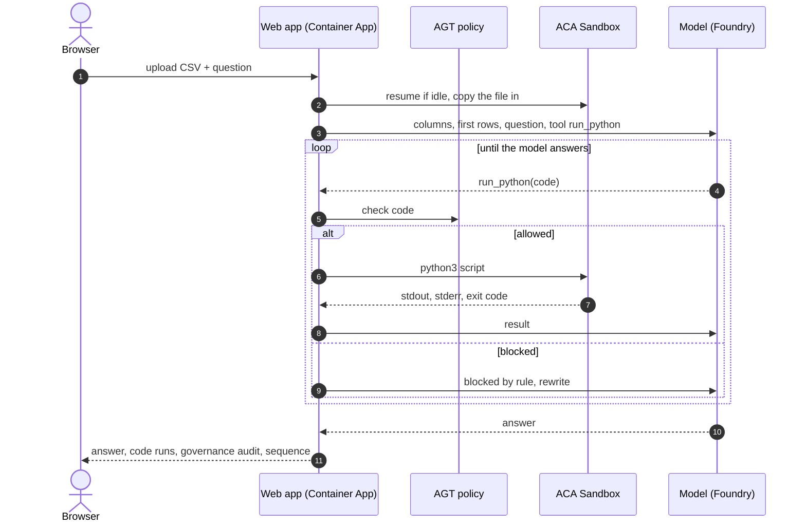

# Pump Alarm Analyzer

**AI writes the Python. An Azure Container Apps Sandbox runs it.**

Upload a file of pump alarms, ask a question in plain language, and an AI model analyzes it by writing
Python. The model's code never runs in the web app: every script is checked by an
[Agent Governance Toolkit](https://github.com/microsoft/agent-governance-toolkit) policy, then runs in an
[Azure Container Apps Sandbox](https://learn.microsoft.com/azure/container-apps/sandboxes-overview), a
hardware-isolated microVM with no outbound network that suspends itself when idle. Everything the model does
is visible: the code, the output, the policy decisions and a trace of the whole sequence.

Built for a talk at the Norway Azure User Group. .NET 10, Aspire, Microsoft.Extensions.AI, OpenTelemetry.

```
Generate  →  Govern  →  Isolate  →  Observe
 model       AGT policy   ACA Sandbox   Aspire dashboard + in-page sequence
```

## How it works



| Piece | Role | Auth |
|-------|------|------|
| **Container App** | UI, analysis loop, policy gate, tracing | — |
| **ACA Sandbox** | runs the Python the model writes (Ubuntu, Python 3, pandas) | managed identity, *Container Apps SandboxGroup Data Owner* |
| **Model** | writes the Python and the answer (OpenAI Responses API via Microsoft Foundry) | API key or Entra |
| **Aspire dashboard** | traces, logs | OTLP |

Details: [ARCHITECTURE.md](ARCHITECTURE.md). Demo runbook: [DEMO.md](DEMO.md). Build log, step by step:
[pump-alarm-sandbox-demo.md](pump-alarm-sandbox-demo.md).

## Features

- **Analysis**: upload a CSV (preview of columns and rows), ask a question, get a markdown answer with the top
  pumps that need attention, the evidence and a suggested action. The model has one tool, `run_python`, and
  fixes its own errors.
- **Governance**: every script is scanned and evaluated against [`governance/policy.yaml`](src/PumpAlarms.Web/governance/policy.yaml)
  with `Microsoft.AgentGovernance`. Network modules, subprocesses, `eval`/`exec`, paths outside `/root`, long
  scripts and too many runs are blocked before they reach the sandbox. A **Governance** panel shows one audit
  row per attempt.
- **Sandbox**: the sandbox badge shows the state (Running / Stopped / Resuming…), with **Pause** and
  **Resume**; the app wakes an idle sandbox before each analysis.
- **Observability**: a **Sequence** waterfall under each answer (model calls with tokens, tool calls, policy
  checks, sandbox execs) and the same spans in the Aspire dashboard (GenAI semantic conventions).
- **Graceful fallbacks**: model + sandbox → AI analysis; sandbox only → fixed pandas analysis; nothing
  configured → stub data, so the UI always works.

## Quick start

### Prerequisites

- .NET 10 SDK, the [Aspire CLI](https://aspire.dev), Docker (for deployment)
- Azure CLI and the [`aca` CLI](https://aka.ms/aca-cli-install-ps) for sandboxes
- An ACA Sandbox group and one sandbox with Python and pandas:

```powershell
aca sandbox create --disk ubuntu --label name=pump-demo
aca sandbox exec -l name=pump-demo -c "apt-get update && DEBIAN_FRONTEND=noninteractive apt-get install -y python3 python3-pandas python3-matplotlib"
```

- A chat model deployment in Microsoft Foundry (the demo uses the OpenAI Responses API)

### Configure

The AppHost takes its settings from user-secrets (never from the repo):

```powershell
cd src/PumpAlarms.AppHost
dotnet user-secrets set Parameters:sandbox-management-url  https://management.<region>.azuredevcompute.io
dotnet user-secrets set Parameters:sandbox-subscription-id <subscription-id>
dotnet user-secrets set Parameters:sandbox-resource-group  <resource-group>
dotnet user-secrets set Parameters:sandbox-group           <sandbox-group>
dotnet user-secrets set Parameters:sandbox-id              <sandbox-id>        # from: aca sandbox list
dotnet user-secrets set Parameters:foundry-endpoint        https://<resource>.services.ai.azure.com/openai/v1
dotnet user-secrets set Parameters:foundry-deployment      <deployment-name>
dotnet user-secrets set Parameters:foundry-key             <api-key>
dotnet user-secrets set Azure:SubscriptionId <subscription-id>
dotnet user-secrets set Azure:Location       <region>
dotnet user-secrets set Azure:ResourceGroup  <resource-group>
```

Use the sandbox **data plane** host (`management.<region>.azuredevcompute.io`), not the portal.
The model endpoint ends at `/openai/v1`; the app adds `/responses`.

### Run locally

```powershell
aspire run --apphost src/PumpAlarms.AppHost
```

Open the app from the Aspire dashboard, upload `samples/pump_alarms_october.csv` and ask
*"Which pumps need attention and why?"*. Your `az login` is used to reach the sandbox.

### Deploy to Azure

```powershell
aspire deploy --apphost src/PumpAlarms.AppHost     # answer the prompts with the values above
.\scripts\grant-sandbox-role.ps1                   # once: gives the app's identity access to the sandbox group
```

`aspire deploy` creates a Container Apps environment with the Aspire dashboard, a container registry, a
user-assigned identity and the app. The sandbox group is not managed by Aspire, hence the role script.

## Project layout

```
PumpAlarms.slnx
src/
  PumpAlarms.AppHost/          Aspire AppHost: parameters, ACA environment, dashboard, identity
  PumpAlarms.ServiceDefaults/  OpenTelemetry, health checks
  PumpAlarms.Web/
    Program.cs                 endpoints: /analyze, /sandbox, /sandbox/stop, /sandbox/resume
    PumpAnalyst.cs             system prompt, run_python tool, the loop
    Governance.cs              code scanner + Agent Governance Toolkit gate + audit records
    governance/policy.yaml     the policy
    SandboxClient.cs           ACA Sandboxes data plane (status, exec, file write, stop, resume)
    TraceCollector.cs          spans of one request for the in-page Sequence
    wwwroot/                   plain HTML, CSS, JS
samples/                       synthetic alarm data (see below)
scripts/                       data generators, sandbox role script, early-step scripts
```

## Demo data

Synthetic, reproducible (`py -3.12 scripts/generate_alarms.py`, `scripts/generate_more_alarms.py`),
same six columns: `timestamp, pump_id, site, alarm_code, severity, duration_min`.

| File | Hidden in it | Try asking |
|------|--------------|------------|
| `pump_alarms_october.csv` (1512) | a pump overheating at night and getting worse, a Monday-morning pattern, a pump that starts dry-running, and a noisy pump that is harmless | *Which pumps need attention and why?* |
| `pump_alarms_q3.csv` (4290) | a heatwave, a site-wide outage, a repair that worked, a wearing bearing, a flapping sensor | *Was there a site-wide incident?* · *Which alarms are noise?* |
| `pump_alarms_storm.csv` (194) | a storm hits every pump; one pump is damaged | *Which pump needs a technician after the storm?* |
| `pump_alarms_messy.csv` (265) | duplicates, mixed date formats, odd pump ids, missing values, typos | *Clean the data, tell me what you fixed, then which pumps need attention.* |

Expected findings for each file are in [DEMO.md](DEMO.md).

## The sandbox API

The app calls the same REST API the `aca` CLI uses:

```
POST https://management.<region>.azuredevcompute.io/subscriptions/<sub>/resourceGroups/<rg>
     /sandboxGroups/<group>/sandboxes/<id>/executeShellCommand?api-version=2026-02-01-preview
Authorization: Bearer <token for https://management.azuredevcompute.io/.default>
{ "command": "python3 /root/step_1.py" }
→ { "exitCode": 0, "stdout": "...", "stderr": "", "executionTimeMs": 1100 }
```

Files are uploaded as base64 through the same call. `GET …/sandboxes/<id>` gives the state; `…/stop` and
`…/resume` pause and wake it. The API is in preview; see ARCHITECTURE.md for what is verified.

## Known limits

- One shared sandbox for all users; production would create one per analysis from a prepared disk image.
- The policy is a text scan, a first filter and audit point; the sandbox is the isolation boundary.
- The model is reached with an API key because it lives in another tenant; keyless needs a cross-tenant app registration.
- No sign-in on the app itself: demo only.

## License

MIT
